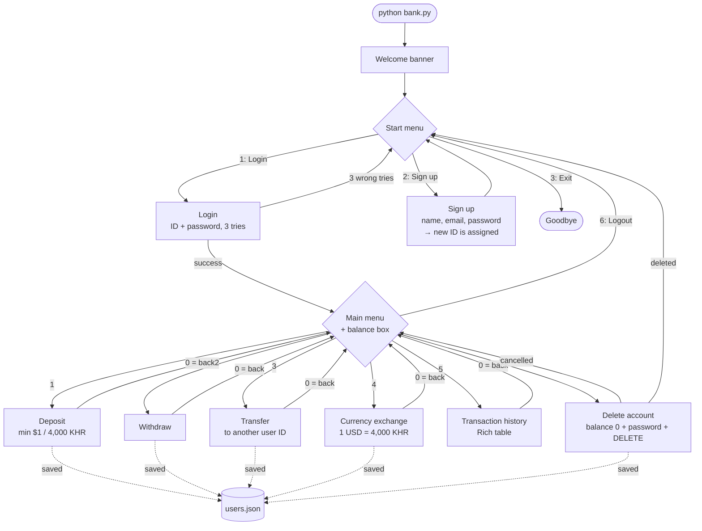
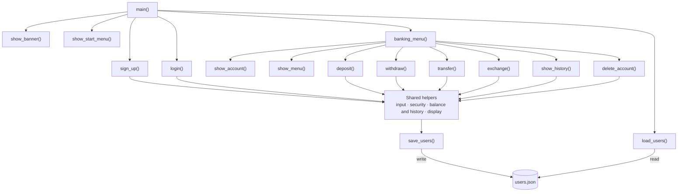

# CLI Bank

A simple banking system that runs in the terminal, written in Python.
Each account holds two balances: **US dollars (USD)** and **Cambodian riels (KHR)**.
All account data is saved in a JSON file, so nothing is lost when you close the program.

---

## What you need to download

| What | Why | Where |
|------|-----|-------|
| **Python 3.8 or newer** | Runs the program (tested on Python 3.13) | <https://www.python.org/downloads/>. On Windows, tick **"Add python.exe to PATH"** during setup. |
| **Rich** (Python library) | Colors, the welcome banner and the transaction tables | Installed with `pip` (see below) |
| **Windows Terminal** *(recommended, Windows only)* | Shows the full cyan and electric-green colors | Already included in Windows 11; otherwise get it from the Microsoft Store |

Everything else the program uses (`json`, `hashlib`, `getpass`, `uuid`, `datetime`) comes with Python.

## How to run it

1. Open a terminal in the project folder.
2. Install Rich (only needed once):

   ```bash
   pip install -r requirements.txt
   ```

3. Start the bank:

   ```bash
   python bank.py
   ```

To check your Python version, run `python --version`.

## Built-in account

| ID | Password |
|----|----------|
| `1000` | `admin` |

You can create more accounts with **Sign up**.

---

## Features

### Sign up
Enter your **name**, **email** and a **password** (at least 4 characters, typed twice to confirm).
The bank gives you an **ID** automatically (the next number after the highest existing ID, e.g. 1001, 1002, …)
and shows your new ID and name. New accounts start with $0.00 and 0 KHR.

### Login
Log in with your **ID** and **password**. You get 3 attempts before access is refused.
Passwords are hidden while you type and are never stored as plain text: only a SHA-256 hash is saved.

### Automatic balance display
After you log in, a box above the main menu always shows your name, ID, email and both balances.
It updates every time you come back to the menu.

### Deposit
Choose USD or KHR, then enter the amount.
- Minimum deposit: **$1.00** or **4,000 KHR**
- Riels must be whole numbers; dollars can have up to 2 decimal places (cents)
- The screen stays open so you can make several deposits. Choose **0** to go back.

### Withdraw
Choose USD or KHR, then enter the amount. You cannot withdraw more than your balance.
Choose **0** to go back.

### Transfer
Send money to another account by entering its ID. The bank shows the receiver's name and asks you to
confirm before sending. You cannot send money to yourself. Enter **0** at the ID prompt to go back.

### Currency exchange
Convert money between your own USD and KHR balances.
- Rate: **1 USD = 4,000 KHR** (fixed; see *Settings* below to change it)
- **USD → KHR:** every dollar becomes 4,000 riels.
- **KHR → USD:** you receive whole cents only (40 riels = 1 cent at the default rate). Riels too small to
  make a full cent stay in your account. For example, 4,039 KHR becomes $1.00 and the 39 KHR is kept.
- You see the exact result and confirm (y/n) before anything changes. Choose **0** to go back.

### Transaction history
Shows all your transactions in a table, newest first. Each row has:

| Column | Example |
|--------|---------|
| Transaction ID | `TXN-3D775498` |
| Timestamp (date, time and time zone) | `2026-11-18 16:04:03 +0700` |
| Type | Deposit, Withdrawal, Transfer In/Out, Exchange In/Out |
| Amount (green for money in, red for money out) | `+$10.00`, `-4,000 KHR` |
| Balance after the transaction | `$8.50` |
| Details | `To josh (ID 1001)` |

A transfer appears in **both** accounts with the **same transaction ID**, so it can be traced.
An exchange creates two rows (Exchange Out and Exchange In) that also share one ID.
Enter **0** to go back.

### Delete account
Permanently deletes your account and its transaction history.
- Your balances must be **$0.00 and 0 KHR** first, so no money is lost. Withdraw or transfer the rest
  before deleting.
- You must enter your **password** again and then type **`DELETE`** (in capital letters) to confirm.
  Anything else cancels.
- After deleting, you are logged out. The account can no longer log in or receive transfers.
- The deleted account's ID is **never given to a new user**, because other people's transaction history
  may still mention it. `users.json` keeps only a small placeholder for that ID
  (`{"deleted": true, "deleted_at": "..."}`). Your name, email, password and history are removed.
- The built-in **admin** account (ID 1000) cannot be deleted.

---

## Diagrams

The diagrams are written in [Mermaid](https://mermaid.js.org/). They show as pictures on GitHub, GitLab,
and in VS Code with the *Markdown Preview Mermaid Support* extension. Other viewers show the diagram code
as text.

### Feature flow

What a user can do, screen by screen. Solid arrows are menu choices; dotted arrows show which features
save to `users.json`.



### Function map

How the functions in `bank.py` call each other. `main()` runs the start menu, `banking_menu()` runs the
main menu after login, and every feature uses the shared helpers listed below.



### Function reference

| Group | Function | What it does |
|-------|----------|--------------|
| **Menus** | `main()` | Shows the banner, loads the accounts, runs the start menu |
| | `banking_menu()` | Runs the main menu after login, until logout or account deletion |
| | `show_start_menu()`, `show_menu()` | Print the menu options |
| **Account features** | `sign_up()` | Creates an account and shows the new ID and name |
| | `login()` | Checks ID + password (3 tries) |
| | `delete_account()` | Deletes the account after the balance, password and `DELETE` checks |
| **Money features** | `deposit()` | Adds money (minimum $1 / 4,000 KHR) |
| | `withdraw()` | Takes money out (not more than the balance) |
| | `transfer()` | Moves money to another account |
| | `exchange()` | Converts between USD and KHR |
| | `show_history()` | Shows the transaction table |
| **Input helpers** | `ask()` | Asks a question with a cyan prompt |
| | `ask_password()` | Asks for a password without showing it |
| | `ask_currency()` | Lets the user pick USD, KHR or go back |
| | `ask_amount()` | Asks for an amount until it is valid (or 0 to go back) |
| | `wait_for_back()` | Waits for the user to enter 0 |
| **Security helpers** | `hash_password()` | Turns a password into a SHA-256 hash |
| | `is_active()` | Checks that an account exists and is not deleted |
| | `next_user_id()` | Picks the next free account ID |
| **Balance and history helpers** | `update_balance()` | Adds or subtracts money from a balance |
| | `add_transaction()` | Saves one row in the transaction history |
| | `make_transaction_id()` | Creates an ID like `TXN-3D775498` |
| | `current_timestamp()` | Returns the date, time and time zone |
| **Display helpers** | `show_banner()`, `blend_color()` | Draw the cyan-to-green welcome banner |
| | `show_account()` | Shows the balance box above the main menu |
| | `title()`, `success()`, `error()`, `info()` | Print colored headings and messages |
| | `format_money()`, `format_signed_money()` | Format amounts like `$1,200.50` or `-4,000 KHR` |
| **Storage** | `load_users()` | Reads `users.json` |
| | `save_users()` | Writes `users.json` |

---

## Files

| File | What it is |
|------|------------|
| `bank.py` | The program |
| `users.json` | Saved accounts: name, email, password hash, balances and transaction history |
| `requirements.txt` | The Python libraries to install (Rich) |
| `README.md` | This file |

Example of one account in `users.json`:

```json
"1000": {
    "name": "admin",
    "email": "admin@example.com",
    "password_hash": "8c6976e5b5410415bde908bd4dee15dfb167a9c873fc4bb8a81f6f2ab448a918",
    "balance": {
        "USD": 0.0,
        "KHR": 0
    },
    "transactions": []
}
```

## Settings

These values are at the top of `bank.py` and can be changed:

| Setting | Default | Meaning |
|---------|---------|---------|
| `EXCHANGE_RATE` | `4000` | Riels per 1 US dollar |
| `MIN_DEPOSIT` | `$1` / `4,000 KHR` | Smallest deposit allowed in each currency |
| `MIN_PASSWORD_LENGTH` | `4` | Shortest password allowed at sign-up |
| `MAX_LOGIN_ATTEMPTS` | `3` | Wrong logins allowed before access is refused |
| `CYAN`, `ELECTRIC_GREEN` | `#00FFFF`, `#39FF14` | Theme colors |

## Notes

- This is a learning project, not real banking software. A real bank would store money as whole cents,
  use a slow salted password hash (such as bcrypt), and keep data in a database.
- The big welcome banner needs a window about 110 characters wide. In a narrower window it switches to a
  plain one-line title.
- If the colors don't show, run the program in Windows Terminal (or any modern terminal) instead of an
  old command prompt window.
# Python-BankingSystem

